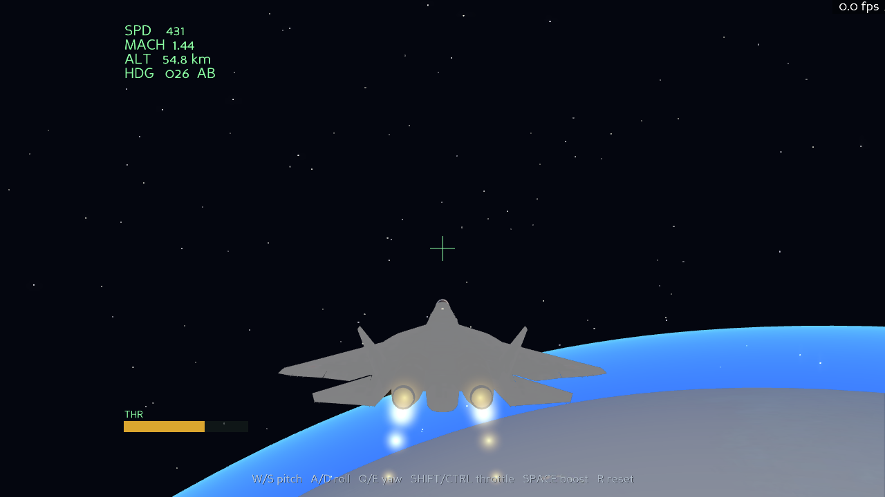

# Afterburner

A cinematic 3D fighter jet simulator built with [Panda3D](https://www.panda3d.org/):
fly a high-detail **Su-57 Felon** at the edge of space, over the curved Earth,
lit by a golden-hour sun, with twin afterburners and a glowing atmosphere.



## Features

- **High-detail Su-57 glTF model** (landing gear retracted, nozzles located for
  the afterburner), loaded via `panda3d-gltf`
- **Edge-of-space world**: the curved Earth below (NASA Blue Marble), a star
  field, and a real-time **atmosphere limb glow** (custom GLSL fresnel shader)
- **Golden-hour lighting** — a warm low sun, cool earthshine fill, and a bloom
  post-process so the sun and afterburners flare
- **Twin afterburner** with dynamic engine lights that flare with throttle
- Arcade flight model: pitch / roll / yaw, throttle, afterburner boost
- Smooth chase camera with speed-reactive field of view
- Heads-up display: airspeed, Mach, altitude and heading

If the Su-57 model is missing, the sim falls back to a procedural jet.

## Install

```bash
python -m pip install -r requirements.txt
```

## Fly

```bash
python main.py
```

## Controls

| Key | Action |
| --- | --- |
| `W` / `S` | Pitch nose down / up |
| `A` / `D` | Roll left / right |
| `Q` / `E` | Yaw left / right |
| `Shift` / `Ctrl` | Throttle up / down |
| `Space` | Afterburner boost |
| `R` | Reset |
| `Esc` | Quit |

## Credits & licenses

- **Su-57 Felon** 3D model — *"Sukhoi Su-57 Felon - Fighter Jet - Free"* by
  **bohmerang** ([Sketchfab](https://sketchfab.com/3d-models/sukhoi-su-57-felon-fighter-jet-free-59995d6f34ba4bb7990195be3a745fc5)),
  licensed **CC BY-NC-SA 4.0**. The glTF adaptation (LODs, grouped control
  surfaces) is from the [OpenFlightSim](https://github.com/KindaBad/OpenFlightSim-public)
  project, offered under the same license. Full notice: [`assets/SU57_LICENSE.md`](assets/SU57_LICENSE.md).
- **Earth texture** — NASA Blue Marble (public domain), via the
  [three.js](https://github.com/mrdoob/three.js) example assets (MIT).

Because the Su-57 model is **CC BY-NC-SA 4.0**, this project is for
**non-commercial use** and must keep the attribution above.

The simulator source code in this repository is free to use and modify.

## Requirements

- Python 3.9+
- Panda3D 1.10+
- panda3d-gltf
